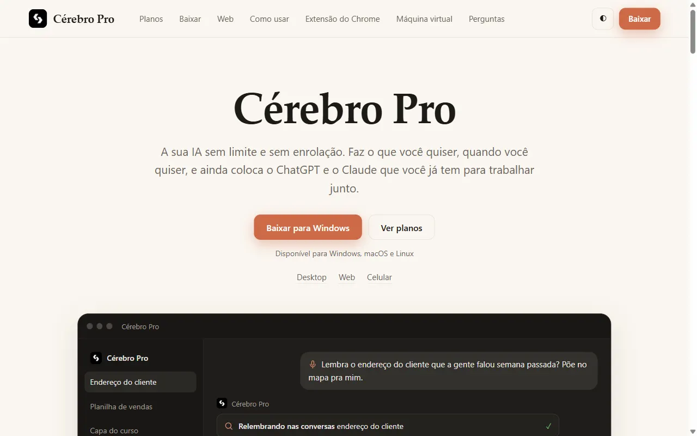

<!-- readme-padrao -->
# Segundo Cérebro: site

> Site de venda do Segundo Cérebro (planos, download, extensão, "Como usar").

## O que é
Site de venda do Segundo Cérebro (planos, download, extensão, "Como usar").

Estado: **no ar**.

## Onde está no ar
- https://segundocerebro.pro

## Onde faz o deploy
Este repositório **só publica** o artefato (release com imagem e manifesto); **quem implanta é o `vps_rt_infra`**.

- Serviço `brain-site`: `gh workflow run deploy.yml --repo RangelTech/vps_rt_infra -f service=brain-site` (só validar: `-f dry_run=true`; voltar versão: `-f version=<tag-antiga>`)

Os `.env` desses serviços são gerados do Infisical no momento do deploy (spec 57, seção 0A).

## Como funciona por dentro
Resumo acima; os detalhes estão nas notas técnicas (README anterior) abaixo e na spec 57.

## Segredos
Nenhum valor de segredo fica neste repositório. Os segredos dos serviços ficam no Infisical (mapa em `vps_rt_infra/scripts/infisical/mapa_envs.json`) e chegam à VPS gerados no deploy.

## Rodar e testar localmente
Ver as notas técnicas abaixo (cada repositório tem o seu jeito); os testes de QA em produção são por cliques reais, com evidência em `new_ragente/qa/evidencias`.

## Links
- Repositório: https://github.com/RangelTech/segundo_cerebro_site
- Painel único: https://painel.rangeltech.net
- Spec de organização geral: `new_ragente/specs/57_ORGANIZACAO_GERAL_PRODUTOS_E_PAINEL.md`

## Notas técnicas (README anterior)

# segundo_cerebro_site

Site de venda do Cérebro Pro (`https://brain.rangeltech.net`). HTML, CSS e JS estáticos servidos por nginx, sem etapa de build.

- `public/assets/config.js`: `checkout.pro|max|ultra|infinity|vm` (links `https://pay.cakto.com.br/<oferta>`), `web` (acesso pelo navegador) e `api` (llm-access). Link vazio faz o botão mostrar "Em breve".
- Download: o JS lê a última release de `RangelTech/second-brain` e aponta cada botão para o instalador do sistema do visitante.
- `public/definir-senha/`: página do link de definir senha (chama `/v1/auth/set-password` do `llm-access`).
- Seção "Máquina virtual": plano com computador dedicado na nuvem, acessado pelo navegador.

## Rodar e lançar

Prévia local: `python -m http.server 9710 --directory public`.

Versão: tag `v*` gera a imagem e o manifesto. O deploy é só pelo `vps_rt_infra`: `gh workflow run deploy.yml -f service=brain-site` (ele busca a última release na hora).

Para trocar um link de checkout, edite `config.js` e lance uma versão nova. Os produtos e ofertas ficam na Cakto (ids em `personal-skills/secrets/cakto.env`).

Mapa geral do ecossistema: skill `ecossistema_rt` (repositório `personal-skills`).

## Teste grátis (`/testar/`)
Página estática (`public/testar/`) que fala com a API pública `/v1/free/*` do llm-access: cadastro com código por e-mail, 5 perguntas por pessoa
e, quando acabam, o bloco de planos do site. O bloco de planos do paywall é uma CÓPIA do de `public/index.html`: depois de mudar planos/preços
rode `node sincronizar-testar.js`. O limite (5) é do servidor (setting `free_questions`); a tela só mostra o que o servidor devolve.
